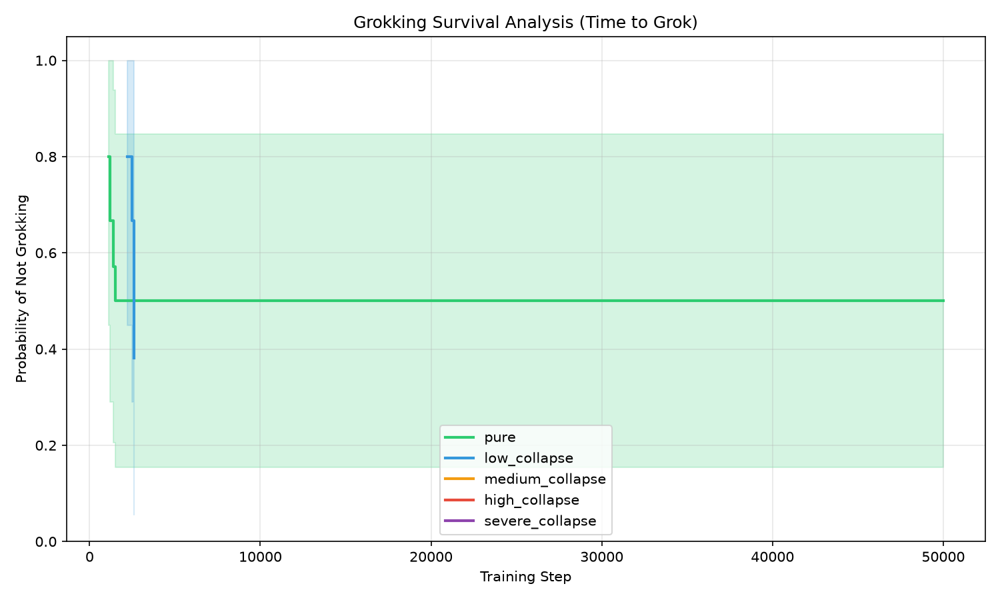
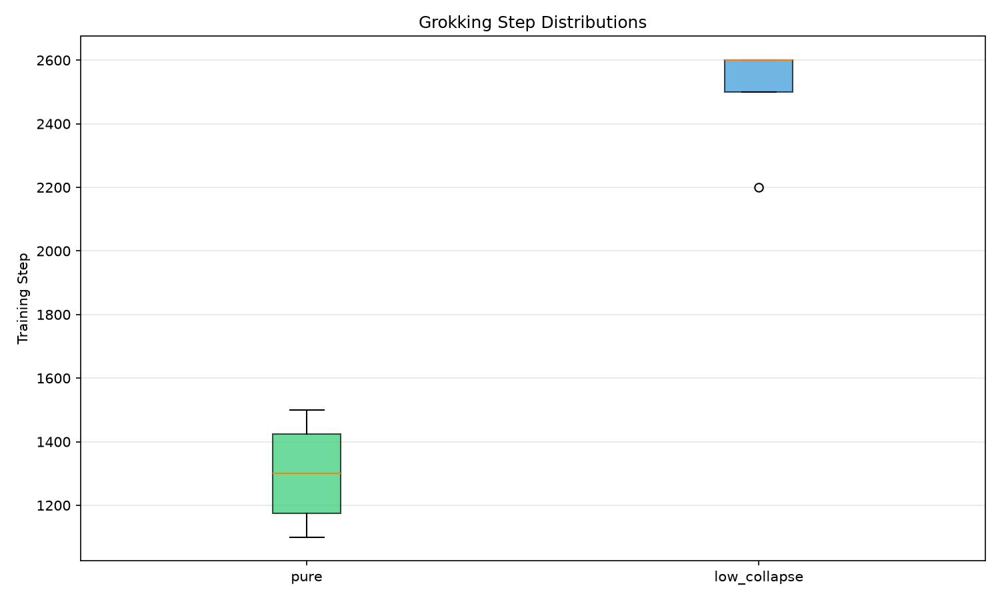

# Grokking Cliff Rigor Analysis

This report re-evaluates the headline grokking cliff results with rigorous statistical bounds, changepoint detection, and survival analysis to properly handle finite-compute censoring.

## 1. Grokking Survival Curves

We frame 'did not grok' as a right-censored event using a Kaplan-Meier estimator. The survival curves below represent the probability of a model *not* having grokked by a given step.

## 2. Grokking Step Distributions

For runs that did grok, the distributions of detected changepoints (grokking steps) are shown below:

## 3. Aggregate Statistics

| Condition | Runs | Grokked | Median Grok Step | IQR | Max Grok Step |
|-----------|------|---------|------------------|-----|---------------|
| pure | 5 | 4 | 1300.0 | 250.0 | 1500.0 |
| low_collapse | 5 | 5 | 2600.0 | 100.0 | 2600.0 |
| medium_collapse | 5 | 0 | N/A | N/A | N/A |
| high_collapse | 5 | 0 | N/A | N/A | N/A |
| severe_collapse | 5 | 0 | N/A | N/A | N/A |

## 4. Method Comparison

We compared three changepoint detection methods on the first `pure` data run:

- **Seed**: 45
- **Piecewise Linear (Min SSE)**: 1100.0
- **Smoothed Derivative**: 1200.0
- **Bayesian Online (BOCD)**: 800.0

The piecewise linear method was chosen as the robust default for the aggregate statistics above.

### Pairwise Statistical Comparisons

| Comparison | Log-Rank p-value | Permutation p-value (Median) | Significant? (p<0.05) |
|------------|------------------|------------------------------|-----------------------|
| pure vs low_collapse | 2.8374e-01 | 2.4000e-02 | ❌ |
| pure vs medium_collapse | 1.3279e-02 | 1.0000e+00 | ✅ |
| pure vs high_collapse | 1.3279e-02 | 1.0000e+00 | ✅ |
| pure vs severe_collapse | 1.3279e-02 | 1.0000e+00 | ✅ |
| low_collapse vs medium_collapse | 3.3699e-03 | 1.0000e+00 | ✅ |
| low_collapse vs high_collapse | 3.3699e-03 | 1.0000e+00 | ✅ |
| low_collapse vs severe_collapse | 3.3699e-03 | 1.0000e+00 | ✅ |
| medium_collapse vs high_collapse | 1.0000e+00 | 1.0000e+00 | ❌ |
| medium_collapse vs severe_collapse | 1.0000e+00 | 1.0000e+00 | ❌ |
| high_collapse vs severe_collapse | 1.0000e+00 | 1.0000e+00 | ❌ |
